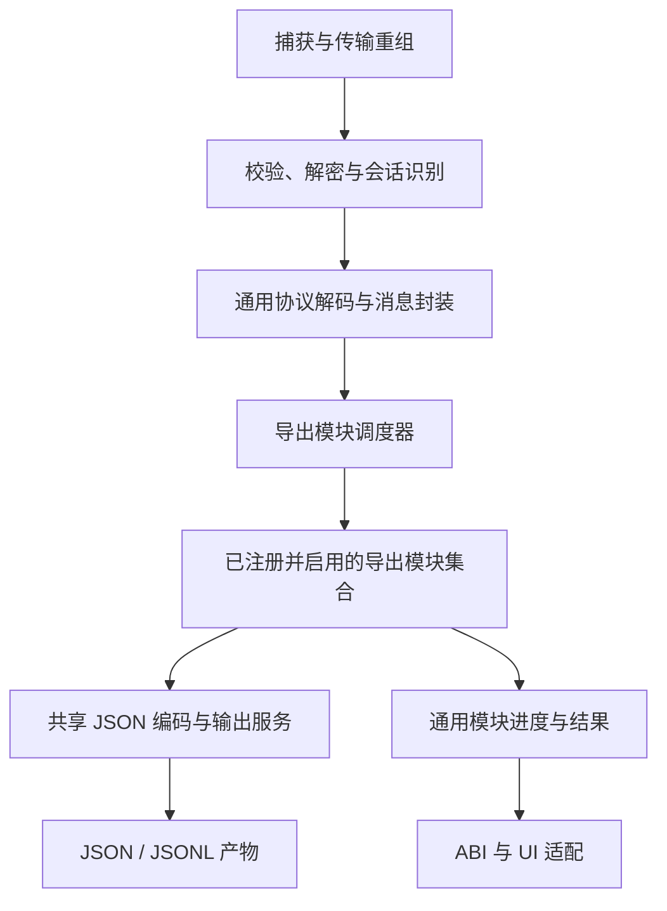

# GameDataExport 统一导出模块实现调研

状态：保留改造前调研与设计基线；已进入实施，当前结构及验收见 [实施与验收记录](GameDataExport-统一导出模块实施与验收.md)。

调研基线：`feature/waves-kcp-capture`，提交 `178b4630af75126e35c7c174e712cb8fb1ba6b45`。

2026-11-06 补充：将多个逻辑数据来源聚合为一个产物的场景，纳入模块契约、版本、一致性、输出回执和验收设计。

本次修订依据：背包是今后多种游戏数据导出中的一种普通模块。背包、完整消息事件，以及未来新增的数据导出，共用相同的注册、调度、生命周期、存储能力和结果协议。本文取代上一轮口头建议中“通用流程旁边保留一条专用背包链路”的设计；此前已提交的修复及验收文档保留为历史实现记录。

## 1. 目标与边界

GameDataExport 的公共能力是：被动取得服务器下行数据，识别其协议和所属会话，将用户选择的数据导出为 JSON 产物。

导出模块可以保存单条消息，也可以根据自己的业务规则将多条消息组成快照。两种方式都是普通模块能力。公共引擎不能预设一定有背包模块，不能用“背包是否收齐”判断连接就绪、捕获成功或其他模块完成。

目标约束：

- 只选择任意一个已注册模块时，该模块能独立工作；所有模块均可禁用。
- 新增一个业务导出模块只需实现模块契约并在组合入口注册，无需修改捕获循环、会话状态机、公共结果汇总或通用 UI 的业务分支。
- 普通 Notify、Response、Push 使用现有协议注册信息完成通用解析和 JSON 输出，不为每个消息类型建立一个导出类。
- 需要聚合的业务数据由相应模块声明订阅消息和完成条件，例如背包模块的四类响应；公共层不解释这些条件。
- 一个产物可以依赖多个逻辑来源；来源可以来自多个消息类型、同一消息的不同字段或多个分页批次。来源状态与合并规则由模块声明，共享设施不预设来源数量。
- 多模块共享捕获、连接识别、KCP 重组、校验、解密、玩家识别和协议解析。模块不重复实现这些设施。
- UI 选择模块并展示公共进度及结果；协议、文件和业务状态处理留在 ABI 业务侧。

本次设计不增加尚未确认的游戏业务规则，普通背包增删改 Notify 仍维持此前搁置决定。改造范围是使各种导出平级，而非增加新的数据合成能力。

## 2. 当前实现事实

下列表中的业务相对路径以 `src/Extensions/Haiyu.ABI/Services/GameDataExport/` 为根；ABI 模型位于 `src/Extensions/ABI/ABI.Models/`，窗口 VM 位于 `src/WutheringWavesTool/ViewModel/ToolkitsViewModel/`。

### 2.1 已经具备的通用能力

| 能力 | 当前位置 | 事实 |
|---|---|---|
| 消息编号和协议元数据 | `Protocol/ProtocolCatalog.cs` | 从固定版本生成资源加载 schema，不动态加载官方程序集 |
| protobuf → JSON | `Protocol/ProtocolJsonDecoder.cs:107` | 按 msgId 查类型并解码；处理嵌套、map、oneof、数值编码、枚举、未知字段和失败状态 |
| 通用消息承载 | `Session/MessageObservation.cs:7` | 包含帧、明文、玩家、登录会话、连接、状态及 JSON 解码结果 |
| 事件接入接口 | `Session/MessageObservation.cs:16` | IGameMessageObserver 只有 Observe 和 Bind，尚不涵盖模块完整生命周期 |
| JSONL 存储 | `Events/EventExportSession.cs` | 有界队列、单写入者、分片、玩家绑定、索引、统计和结束排空 |
| 快照存储 | `Export/InventoryJsonWriter.cs:108` | 临时文件写入后原子替换，失败保留旧文件 |

ProtocolJsonDecoder 当前将 wire 解码与 JSON 编码合并：私有 Node 保存字段树，对外 Result 只返回 JSON 字节、类型及解析状态。这意味着已经存在通用 JSON 导出基础，但还没有可由各种业务模块共同消费的公开内部协议值模型。

### 2.2 仍然将背包特殊处理的位置

| 位置 | 当前特殊处理 | 需要调整的责任 |
|---|---|---|
| `Session/CaptureConnectionState.cs:18` | 构造时直接创建 InventoryCaptureState，持有 Inventory 属性 | 连接只管理传输和会话，业务模块由统一注册器创建 |
| `Session/CaptureConnectionState.cs:32` | Ready 取决于 Inventory.IsComplete | 连接验证与模块业务完成状态分别表达 |
| `Session/CaptureConnectionState.cs:67` | 换钥直接 Reset 背包 | 发布统一登录会话变更通知，由各模块处理自己的状态 |
| `Session/CaptureConnectionState.cs:102` | 每条明文消息直接调用 Inventory.Apply | 消息统一进入模块调度器 |
| `Session/CaptureConnectionState.cs:103` | 背包解析成功参与标记连接有效 | 有效协议流量由协议层确认，不能依赖某种业务模块 |
| `Session/CaptureConnectionState.cs:149` | 重连时直接复制背包状态 | 协议层发布已验证的恢复关系，模块自行处理状态继承 |
| `GameDataExportService.cs:93` | 直接维护背包更新次数、写入版本和失败摘要 | 由模块维护自己的业务状态，公共层收集通用结果 |
| `GameDataExportService.cs:302` | 捕获循环内检查背包收齐、执行重试及写入 | 通用调度器调用模块检查点，不出现背包条件 |
| `GameDataExportService.cs:407` | 直接组装 GameInventoryData、统计四类数量并写文件 | 移入普通的背包导出模块 |
| `ABI.Models/GameDataExportRecord.cs:82` | 结果模型固定为 Inventory、PlayerSummaries 和 EventExport | 增加通用模块结果，旧字段通过边界适配保留兼容 |
| `GameDataExportViewModel` | 启动范围以 Inventory 为基础，结果按背包/事件分支格式化 | 根据模块描述与模块结果展示，业务特殊展示由可选适配器提供 |

因此，本次改造不能只给 InventoryJsonWriter 加一个泛型方法，或者让两个现有类实现一个名称相同的接口。上述直接依赖和完成判定也需要一起迁出公共流程。

### 2.3 两种现有输出的区别

背包模块目前聚合四种响应，映射为约定 DTO，在玩家已确认、数据收齐且版本变化后覆盖同一个 JSON 文件。完整消息模块逐条保存实际观察到的下行消息，使用 JSONL，并处理身份未确认时的待归属事件。

区别属于模块的输出策略。完整消息模块也应是已注册模块，不承担所有模块的默认宿主或必经入口；背包模块也不能作为引擎的基础数据结构。

全量模式下，背包消息目前会经历通用 wire → JSON 解析和专用 Google.Protobuf → DTO 解析。统一消息入口不等于已经消除了重复解析，实现时必须明确这项现状。

### 2.4 当前多来源聚合的实际边界

`InventoryCaptureState.cs:17` 当前将四个字典的键数量相加，与目标响应数量比较；`Store` 使用消息编号覆盖对应列表。这证明的是已经解析过各类响应，尚未形成通用的来源状态、分页或跨来源一致性模型。

核对当前生成的 `Protocol/WavesGameData.proto`：NormalItemResponse、WeaponItemResponse、PhantomItemResponse、ValidTimeItemResponse 没有共同的快照批次字段。不能仅凭四类消息都已到达，就声称产物是同一时刻的服务器原子快照。

PhantomItemResponse 除 phantom_item_list 外，还包含 prop_info、equip_info、unlock_skins 等字段。一个消息类型可以提供多个逻辑来源；当前 InventoryMapper 只映射约定的声骸列表及 DTO 字段。此事实用于设计来源抽象，不意味着本次擅自扩展既有背包文件内容。

## 3. 目标结构

模块集合可包含完整消息、背包以及未来的其他数据模块。图中的公共引擎没有任何具体业务模块引用。

### 3.1 公共引擎

负责模块发现与选择、启动、消息路由、会话通知、检查点调度、结束收尾和结果汇总。只认识统一契约、模块 ID、订阅描述、产物和模块状态。

公共代码不得出现以下逻辑：

- 根据模块 ID 判断是不是 inventory 后调用特殊方法。
- 检查普通道具、武器、声骸或四类响应是否收齐。
- 使用背包版本、背包 DTO 或背包数量定义捕获状态。
- 当未启用某个模块时，跳过其他模块所需的基础协议确认。
- 将一个模块成功直接覆盖另一个模块失败。

### 3.2 导出模块

每个模块负责订阅、数据选择、业务转换或聚合、何时产生输出，以及自己的业务完成条件。背包的四类消息、版本与重试规则均属于背包模块内部实现。

简单模块可以使用通用的“消息筛选 → JSON 输出”实现，通过配置订阅消息；存在聚合规则时再实现专门模块。无需为只改变 msgId 集合的情况创建重复类。

### 3.3 共享服务

公共协议解码、JSON 编码、路径验证、受限输出队列、原子替换、JSONL 分片和写入回执，作为模块依赖提供。共享服务不能反过来调用背包或完整消息模块。

沿用 ABI 业务侧现有目录组织，先采用内部接口和静态注册。此次不引入外部插件加载、运行期程序集扫描或新的大型项目依赖。

## 4. 模块契约

建议定义 IGameDataExportModule，以及显式注册的模块工厂。一个模块实例对应一次捕获；模块内部按登录会话、玩家及自身业务维度隔离状态。

契约至少覆盖下列能力。这里定义责任，不把尚未实现的签名表述为现有 API。

| 契约能力 | 输入/输出与约束 |
|---|---|
| 模块描述 | 稳定 moduleId、显示资源键、支持的配置及订阅消息描述 |
| 聚合描述 | 逻辑来源、必需/可选条件、来源合并模式、业务完成规则及一致性策略；简单事件模块可不使用聚合能力 |
| 启动 | 接收公共 ExportModuleContext，取得输出、日志和时钟等服务；不访问 UI |
| 消费消息 | 接收统一消息封装；轻量处理并提交输出任务，不在捕获循环等待慢盘 |
| 会话变更 | 接收新登录、身份确认、传输恢复、连接退役等明确事件 |
| 检查点 | 按模块声明的节拍处理待输出版本、合并更新或提交刷新请求 |
| 写入回执 | 收到持久化成功/失败结果后推进已写版本、更新次数或重试状态 |
| 进度 | 返回通用状态、计数和产物位置，不把完整消息正文发给 UI |
| 完成 | 停止接受新消息，排空待写任务，返回独立模块结果 |
| 释放 | 释放本模块资源，异常路径也能完成清理 |

消费、会话变更、检查点和写入回执对同一模块串行执行。文件后台线程不直接修改模块业务状态。需要区分“已生成输出”“已提交队列”“已成功持久化”，只有最后一项才允许增加成功写入次数。

IGameMessageObserver 可以作为消息订阅能力被模块契约替代或包含，但它自身不足以代表完整导出模块。

多来源不会增加一套特殊的导出模块生命周期。聚合模块仍通过上述相同契约工作，来源适配与组合属于其内部能力。普通来源无需各自注册为用户可选择的导出模块，也无需各自创建线程或文件队列。

## 5. 统一消息与协议解析

### 5.1 消息封装

统一封装应包含 captureId、本地消息序号、接收时间、connectionId、sessionId、可空 playerId、实际下行方向、帧类型、可空 msgId/rpcId、协议版本、处理状态、错误信息及可用载荷。

正常消息、未知消息、解码失败和 Exception 等控制事件均有明确表示。模块根据订阅能力选择是否消费诊断事件。Exception 的错误码独立保存；未知或失败载荷不能伪造为成功 JSON 数据。

封装不包含 RSA 私钥、可变密码学对象或用于重新解释登录的内部状态。新登录、玩家绑定和重连是否成立由会话层统一判断；模块不能根据背包消息反向决定公共会话。

### 5.2 解析与编码分开

建议从现有 ProtocolJsonDecoder 拆出两个共享步骤：

1. ProtocolDecoder：依据静态 schema，将 protobuf 解码为可只读访问的协议字段模型，保留字段存在性、oneof、精确数值、类型信息和未知字段状态。
2. ProtocolJsonWriter：将该字段模型写成约定的 protobuf JSON，继续保持 int64/uint64、bytes、枚举及未知字段的现有规则。

协议字段模型是现有私有 Node 的受控演进，不能简单暴露可随意修改的 Dictionary<int, object>。模块通过明确的字段访问能力读取数据，不通过 JSON 字符串再反序列化来获得业务字段。

同一消息的解码结果由订阅者共享，JSON 按需生成并在本次消息消费期间复用。每条消息的解析预算与序列化预算分别受限；一次解析成功但 JSON 展开超过限额，也必须表达为编码失败，不能损失解析阶段的事实。

迁移期允许某个模块的兼容适配继续使用类型化 parser，但这项双重解析必须局限在模块内、明确记录为迁移债务。公共引擎不能为背包保留第二条解析路径。最终背包转换应与其他模块一样消费共享协议模型。

### 5.3 公共方法的适用范围

可以复用“协议值 → JSON”和“业务 DTO → JSON”两类公共编码入口。后者显式接收 JsonTypeInfo<T>，保持 NativeAOT 安全，不通过 object/dynamic 或运行期反射查找类型。

已经编码的 UTF-8 JSON 必须作为 JSON 写入，不能将 byte[] 再当普通对象序列化成 Base64。原始 protobuf 或密文的 Base64 诊断载荷则保留单独的编码标记。

接口承担状态与生命周期，公共方法承担确定性的转换和存储操作。不能用一个不断增加模块 ID 分支的 ExportToJson 方法替代模块抽象。

## 6. 统一输出与索引

模块提交通用输出描述：模块 ID、玩家/会话分区、产物用途、JSON 内容、格式、写入策略、版本及元数据。公共输出服务负责校验路径、执行 I/O、限制资源并返回回执。

两种内置写入策略均可供任何模块使用：

- Snapshot：临时文件与原子替换；失败保留上次成功文件，模块保留待写版本。
- JsonLines：受限队列、追加、分片、刷新与结束排空；超限或失败可定位，不静默丢弃。

格式和策略由模块声明。公共服务不根据 inventory 或 server-messages 等具体 ID 选择实现。

模块可以声明自己的产物布局，通用层验证路径和冲突。现有背包文件格式和路径由背包模块的布局/格式适配保留，其他模块也享有相同的布局声明能力。保留历史格式不构成引擎内置业务条件。

现有背包 JSON 和 ABI 结果还包含 sessionKeyHex，不能在迁移时忽略这一兼容字段。其来源应由安全上下文提供受控的只读兼容元数据，交给注册时注入的旧格式适配器；模块不重新解密或管理密钥，也不能为保持旧格式而将私钥、可变密码学对象加入公共消息模型。是否移除历史字段属于另一个明确的兼容性变更，本次不擅自改变。

统一捕获上下文生成一次 captureId 和开始时间，所有模块共享。新增公共捕获索引 `captures/{captureId}/capture-index.json`，汇总模块状态、产物及结束原因。现有事件 `manifest.json` 可继续作为该模块的产物索引登记；它不再被解释为整个 GameDataExport 的总结果。其他模块同样可以有自己的索引，禁止多个写入者争用同一文件。

目前事件默认队列为 512 项/32 MiB、分片 128 MiB、总事件正文 1 GiB。迁移时将其表达为普通模块配额，并增加公共输出的总预算约束；不能让每个模块各占一份完整预算而使总内存随模块数无界增长。

公共输出预算也不能替代业务聚合状态上限。各模块需约束自己的集合和缓存规模，超限时使用一致的故障与收尾协议。

## 7. 会话与完成条件

公共层区分传输是否有效、玩家身份是否确认、模块业务数据是否完整、输出是否持久化。它们不是一个 Ready 布尔值。

新登录由公共层发布统一身份代次变化。所有模块按自己的规则隔离待归属数据和旧玩家状态。传输重连发布恢复关系；模块可延续已确认登录的数据，但新候选传输上的数据在确认前不能覆盖已有成功输出。

模块声明是否需要玩家身份以及自身业务完成条件。完整事件模块可以先写待归属记录，聚合模块可以等待身份后提交快照；公共引擎执行同一套能力规则，不判断是哪一种业务。

合法空数据与没有收到数据分别处理。例如已收到空列表响应可以满足相应模块的完成条件，不能因为项目数量为 0 判失败；尚未收到必需响应则是该模块的数据未完整。

模块的检查点节拍来自模块配置或描述，不在主服务硬编码某模块的每秒重试。停止请求先停止捕获，再通知所有启用模块完成；收尾使用独立于已取消捕获令牌的清理期限，等待最终确认或明确的未完成状态。

### 7.1 逻辑来源与聚合身份

“数据源”在这里指模块组合产物所依赖的逻辑来源，当前重点是服务器下行数据。sourceId 是模块内稳定的来源标识，独立于 msgId：多个 msgId 可以共同更新一个来源，一个消息也可以提供多个来源。

聚合状态至少按 `(captureId, moduleId, sessionId, playerId/待归属身份, viewKey)` 隔离。viewKey 表示模块的业务视图，例如当前角色、某种实体集合或某个区服；没有额外维度时可为空。playerId 尚未确认时，用明确的登录会话身份隔离待归属状态，不能统一放进 playerId=0。

connectionId 用于溯源和候选传输隔离，不直接作为业务快照的唯一归属。已确认的同一登录会话重连可以延续聚合状态；新登录即使玩家或密钥相同，也不能无条件混用旧登录尚未完成的来源。

来源分页的 assemblyId 与跨来源快照的 roundId 分别表达。只有协议或业务证据能建立共同批次时，才据此关联多个来源。模块自己生成一个本地轮次编号，只能表示本地收集边界，不能证明服务器提供了原子批次。

### 7.2 来源声明与独立状态

建议提供可复用的 SourceDefinition 和 SourceState 基础类型，由各模块静态声明适配器和规则；不引入运行期脚本或任意规则 DSL。

| 声明项 | 作用 |
|---|---|
| sourceId 与消息映射 | 指定来源所订阅的消息类型、字段或判别条件；不得仅靠名称后缀猜测语义 |
| 必需性与依赖 | 声明必需、可选或条件必需；条件未知时单独报告，不默认为已经满足 |
| 数据模式 | 全量替换、分页全量、增量变更或仅追加事件；一个来源可有多种明确区分的输入模式 |
| 实体键与合并规则 | 规定如何识别同一实体、更新哪些字段、如何删除，以及冲突处理方式 |
| 完整性证据 | 规定完整响应、页数/结束标记、连续范围或其他可信完成条件 |
| 顺序与版本证据 | 声明可用的服务端版本、序号或批次字段及其作用域；没有证据时保留未知状态 |
| 一致性与新鲜度 | 声明跨来源组合方式、可接受的数据年龄、是否需要同一刷新轮次 |
| 资源与等待限制 | 限制实体数量、分页缓冲、待基线增量、去重记录及等待时间 |

每个来源维护自己的收集状态、完整性、新鲜度、已接受版本及错误。来源至少能表达 Missing、Collecting、Ready、AwaitingBaseline 和 Invalid；Stale 等新鲜度信息独立保存，不用一个布尔值掩盖“数据存在但已过期”。

来源状态还需分别保存上次验证完整的基线与正在构建的新状态。新批次组装或校验失败时，记录本次失败但不破坏旧基线；旧基线是否仍可参与本轮组合，依据声明的一致性、新鲜度和刷新轮次规则决定，不能自动当作本轮已刷新成功。

来源内容为空与来源尚未取得必须分开。成功的合法空列表可成为 Ready；一个 protobuf 恰好能解析为空对象，并不自动证明业务请求成功、全量已完整或身份正确。

### 7.3 完成条件与来源间组合

模块先校验单个来源，再判断整体业务条件。允许写出完整聚合快照的基本条件是：身份/会话条件满足、所有必需来源完整、条件依赖已解决，并满足模块声明的一致性规则。公共引擎只读取模块给出的状态。

- 必需来源缺失时保持等待或在结束时报告 Incomplete，不填空数组冒充已取得数据。
- 可选来源缺失时可先导出，但需在产物元数据中明确缺失情况；来源随后到达时按模块规则生成新版本。
- 条件必需来源依据业务能力或字段证据启用；不能把不适用于当前玩家的来源永久列为必需。
- 分页来源只有在完整性证据满足后才替换其上次成功的完整状态。最后一页先到、缺页或重复页均不能被简单累计为完成。
- 不得按长时间无消息、抓到四个包或 msgId 数量达到某值推断任意模块已经收齐。

来源之间可以并列组成分区、按实体键关联、按显式优先级覆盖，或产生派生字段。这些组合规则由模块适配器表达，不能让通用 JSON 字段覆盖或列表拼接替代业务合并。

当前背包的四类列表是并列组合的例子。其他模块如果需要把“实体列表来源”和“属性来源”按 ID 关联，则必须声明关联键、允许缺失的字段和关联基数；缺失必需关联时不能填 0 或沿用其他玩家的属性。这里是通用设计示例，不是已确认的游戏新业务规则。

默认不通过读取另一个模块的导出文件获得来源，也不能隐含要求先开启背包模块。多个模块可以共享同一份只读协议解析结果，各自维护自己的聚合状态；将来确有共享来源提供器需求时，再显式定义其依赖与生命周期。

### 7.4 全量、分页与增量的组合

全量响应只替换所属来源及其声明范围，不能顺带清空其他来源。新全量或分页批次先在受限的待组装状态中构建，通过校验后再发布；一次失败不能破坏上次成功的完整基线。

增量来源必须有可用基线。模块需明确增加、更新、删除、清空和字段缺失各自的含义；不能假设所有通知都是整表替换，也不能假设数值字段一律累加。删除后不能因错误的全量/增量顺序使实体重新出现。

增量先于基线到达时，仅在协议提供足够的版本/顺序证据时，才按声明规则受限缓存并在基线后重放。缓存超限、顺序无法判定或基线始终缺失时，报告 AwaitingBaseline/Incomplete 并保留可追溯诊断，不能猜测性合并。

有来源版本时，要验证适用范围、重复、迟到和缺口，再应用全量及增量。没有来源版本时，只能采用经过协议证据支持的顺序规则，并记录其限制。跨接口、跨连接、KCP 与裸 UDP 之间的本地到达先后不能自动视为服务器业务顺序；KCP 段号也不能直接作为业务数据版本。

传输重传与业务幂等分别处理。合法的重复内容可能属于不同操作，不能仅按消息体哈希丢弃；有业务操作 ID 或来源版本时按其作用域去重。具体规则必须来自源码或可信抓包，缺少证据时不启用猜测性的增量合成。

这部分是未来聚合能力的设计约束。当前尚未确认的普通背包增删改 Notify 继续搁置；本次调研不会将其描述为已经支持或准备直接启用。

### 7.5 跨来源一致性与刷新轮次

模块必须区分至少两种一致性策略：

| 策略 | 可以承诺的范围 |
|---|---|
| StrictBatch | 所有必需来源依据可信的共同批次/事务证据属于同一快照，缺少证据时不能声明成功满足此策略 |
| LatestComplete | 使用当前登录会话内各来源最近一次已验证的完整状态；可以证明来源完整，但不能保证它们来自服务器同一时刻 |

当前四类背包响应没有共同批次字段，不能默认按 StrictBatch 解释。迁移时采用 LatestComplete，并将这一限制写入聚合溯源信息；将来若取得新的协议证据，再由模块更新策略。

若只更新了来源 A，而 B、C、D 仍为同一登录会话内有效状态，LatestComplete 可按模块声明生成新快照，不必每次等待所有来源重发。若模块声明一次新的完整刷新轮次，旧轮次尚未刷新的必需来源则不能充当本轮已完成数据。

来源间数据过旧是否阻止发布，由模块声明的新鲜度要求决定；不能给所有模块强加同一个时间窗口。使用本地接收时间判断年龄时，需明确它不是服务器数据版本，超时计量应支持可推进时钟的离线测试。

### 7.6 不可变快照、版本向量与持久化回执

聚合模块需区分以下版本/计数：

- SourceVersion：每个来源已接受的有效版本；服务端版本与本地版本分开记录，不能将本地递增值冒充服务端版本。
- SnapshotRevision：模块组合出的不可变候选产物版本，带有本次使用的来源版本向量。
- PersistedRevision：已经收到持久化成功回执的产物版本。
- updateCount：本次捕获中该玩家、该模块成功持久化新产物版本的次数；同版本重试和重复回执不重复累计。

多个来源连续变更时，可以按检查点合并为一次新产物，不要求每条输入消息都立刻写文件。哪些语义变更形成新版本由模块声明，输入消息数量与产物更新次数分别统计。

提交给后台写入的快照必须冻结，或采用安全的不可变结构；不能让序列化过程中正在更新的来源改变同一个产物，产生前后不一致的列表或字段。

写入任务及回执包含模块、玩家、登录代次、产物目标、SnapshotRevision 和来源版本向量。版本 V 正在写入时若又形成 V+1，V 的成功回执只能确认 V，不能把 V+1 的待写状态一并清除。写入失败重试同一版本不能增加更新次数；更新版本到来后可按声明策略替换尚未执行的旧快照任务，并记录被替代情况。

同一快照目标的提交必须有明确的串行/版本保护。新登录接管相同路径后，旧代次晚完成的任务或回执不得覆盖新代次的文件或状态。该约束适用于可覆盖的快照产物；追加事件流仍需保留已接收的合法历史事件，不能套用“丢弃旧代次快照”的策略。

### 7.7 聚合溯源与通用进度

模块进度与产物元数据应包含来源完整性及当前聚合状态，而不仅是一个百分比。至少可定位必需来源总数、已满足来源、缺失/无效/过期来源、是否存在待基线增量、当前一致性策略，以及候选/已写版本。

已发布聚合产物应能追溯使用的来源版本、所属登录代次、相关消息或接收范围和来源接收时间。没有可信的共同服务器时刻时，不伪造统一的“服务器快照时间”。接收时间、产物生成时间和成功持久化时间也分别表达。

这些信息采用通用 SourceProgress/ArtifactProvenance 等结构，由模块提供名称与状态，UI 不硬编码 normalItems 或“4/4”。旧 JSON 格式不能直接增加字段时，将溯源信息写入模块索引或公共捕获索引中的产物元数据，继续保留旧文件兼容。

### 7.8 停止、重连与不完整数据

正常停止时，只提交满足完整性及一致性条件的最终待写快照，再等待回执。当前轮次不完整时保留此前成功产物，结果指出未完成的来源和最后成功版本；不能把旧文件存在等同于本轮已经完整成功。

没有任何来源输入可以是 NoData；已经收到部分数据但缺少必需来源应报告 Incomplete；合法空来源收齐可以是成功。模块如需保存不完整诊断产物，应显式标记并使用独立产物用途或路径，不能替换成功快照或冒充完整结果。

同一登录会话的已确认重连保留来源状态、待写版本和已写版本。候选连接确认前的数据受限暂存或保留为待验证事件，不推进已确认的业务快照。新登录隔离所有未完成来源，先前成功文件和按玩家累计的成功次数按既有规则保留。

### 7.9 可复用实现边界

建议在模块内部复用来源状态、完整性组合、版本向量与不可变快照提交等基础类型；协议字段适配、实体键、分页结束证据、全量/增量合并和来源间关联由模块静态实现。

公共调度器仍只认识模块契约，不出现四来源、背包字段或特定数据合并分支。简单消息导出模块可直接使用普通消息到 JSON 的输出路径，不必创建没有用途的聚合状态机。

## 8. 统一进度、结果与失败策略

请求通过稳定模块 ID 选择导出内容，结果返回模块结果集合。每个结果至少包含 moduleId、状态、错误、玩家摘要、计数和产物引用。计数的名称与含义由模块描述，公共 UI 不预设四类背包数量。

聚合模块可附加通用来源进度、缺失原因和产物溯源，仍由同一模块结果集合承载，不增加一个独立的“背包聚合结果”公共分支。

模块状态至少区分运行中、等待数据/身份、收尾中、成功、无数据、未完整和失败；捕获结果根据所有启用模块统一汇总。未启用模块不参与判定，任何模块均无隐含必选地位。

默认采用一致的受控停止规则：普通未知/解码失败消息被记录，不自动终止其他消息；模块不可恢复故障触发本次捕获受控停止并统一收尾。协议、密钥或共享输出设施的不可恢复故障同样进入公共停止流程。始终保留其他模块此前成功的产物，汇总为明确的部分成功/失败，不以某个模块成功覆盖失败。

将来如需模块故障隔离，应通过统一策略表达，并适用于所有模块；此次不增加只针对某个模块的容错分支。

原有 GameDataExportScope、GameDataExportResult.Inventory、PlayerSummaries 和 EventExport 在 ABI 边界做兼容映射。新引擎内部只使用模块结果集合。旧模型不能反向规定新引擎的结构；适配代码不得进入捕获循环。

UI 从模块描述获得选择项，从通用进度和结果渲染状态。既有“默认选中背包”可以作为可替换的用户配置/预设保留；未选背包时不得自动创建它或使其他导出失效。没有选中任何模块时，应在启动前返回明确的配置结果。

## 9. 现有代码迁移清单

| 当前实现 | 迁移目标 |
|---|---|
| CaptureConnectionState.Inventory / Ready | 删除业务属性，保留协议会话状态和统一消息输出 |
| 连接内 Inventory.Apply / Reset / ForkForReconnect | 改为消息与会话通知；由普通模块维护数据 |
| InventoryCaptureState、InventoryMapper | 收入 InventoryExportModule 的内部实现或其兼容适配 |
| 四个来源字典及按种类计数的 IsComplete | 演进为模块声明的来源状态与完整性规则；可复用基础类型不固定来源数量 |
| GameDataExportService.BuildAndWriteAsync | 移入模块；主服务改为遍历启用模块 |
| 主服务内背包版本、次数、失败摘要和重试字典 | 业务信息归模块，公共调度只处理模块契约与回执 |
| EventExportSession | 作为 ServerMessagesExportModule 的实现基础，接入同一生命周期 |
| ProtocolJsonDecoder | 拆分公共解码结果与 JSON 编码，保留已有协议规则及 AOT 能力 |
| InventoryJsonWriter 的原子写逻辑 | 提取共享 Snapshot 输出策略，背包仅提供内容与布局 |
| EventExportSession 的队列、分片和文件操作 | 抽成共享 JsonLines 输出策略，模块保留事件格式与统计语义 |
| 固定背包/事件 ABI 及 UI 分支 | 通用模块模型加边界兼容适配 |

## 10. 实施顺序与验收

建议按可验证的步骤迁移：

1. 建立通用模块描述、消息、会话通知、进度、结果和输出契约；定义注册入口及兼容边界。
2. 拆出共享协议值模型与 JSON 编码，保留独立 wire 向量和 NativeAOT smoke。
3. 建立来源状态、聚合身份、完整性/一致性规则及不可变快照提交的基础能力，用合成来源验证单来源和多来源；将现有完整消息与背包作为两个平级模块接入，迁走公共层所有业务完成判定及写入调度。
4. 接入共享输出策略、写入回执及公共捕获索引，保留现有产物兼容。
5. 将 ABI/UI 改为模块集合驱动，再用完整回归和 Windows 实机确认行为。

验收应证明：

- 仅启用任意模块、同时启用多个模块、禁用背包和没有模块的行为均明确。
- 增加一个测试用导出模块只修改模块实现与注册，不修改捕获循环、协议状态机或通用 UI 分支。
- 测试模块可订阅已有的非背包下行消息，生成 JSON 并独立报告完成；无需实际实现新的游戏业务模块。
- 背包原有文件格式、更新次数、A→B→A、合法空列表及失败重试仍正确。
- 同一聚合逻辑适用于一个、多个及不同数量的来源；来源数变化不修改公共引擎。
- 必需/可选/条件必需来源、成功空来源、缺失来源和关联字段不完整分别得到正确结果。
- 多来源以不同顺序到达、单个消息提供多个来源、某个来源重复更新时，不漏数据或误判收齐。
- 分页乱序、重复页、缺页和新旧批次交错，不产生伪完整基线；来源 A 的更新不清空来源 B。
- 合成增量覆盖基线前到达、重复、迟到、删除、版本缺口及缓冲超限；不将这些测试视为已确认背包 Notify 语义。
- LatestComplete 的单来源更新和 StrictBatch 的批次完整性各自符合声明，不能混用轮次或伪称服务器原子快照。
- 写入中的快照不被后续消息修改；V 的迟到回执不清除 V+1，重试/重复回执不重复增加次数，旧登录任务不覆盖新登录文件。
- 来源缺失或过期时停止，能保留最后成功文件并报告当前轮次未完整；诊断产物不替换成功快照。
- 所有模块统一经历换钥、身份待确认、玩家绑定、重连、退役和停止；没有共享旧玩家数据。
- 单模块写入失败、共享配额不足及停止超时不会伪报整体成功，已有产物可追溯。
- 模块组合不造成无界内存或阻塞 UI；并行文件 I/O 不跨线程修改模块状态。
- 通用解析覆盖数值精度、未知字段、异常控制帧和失败载荷；不从 JSON 反推 protobuf。
- 普通编译、现有回归和 Linux NativeAOT smoke 通过；Windows 实机按对应步骤验证捕获、凭据、UI 和发布产物。

以上记录调研阶段的目标与约束。随后实施及验证记录见 [统一导出模块实施与验收](GameDataExport-统一导出模块实施与验收.md)。
